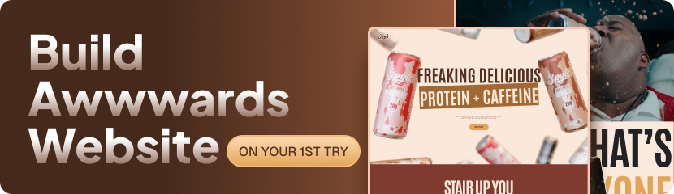

<div align="center">
  
  <br />
  <br />
  
  
  
  <h1 style="font-weight:700;font-size:2.2rem;">SPYLT Website</h1>
  <p>An award-style, interactive product site built with <b>GSAP</b>, <b>ReactJS</b>, and <b>Tailwind CSS</b>.</p>
  <p><b>Author: Muhammad Muneer</b></p>
</div>

---

## 📋 Table of Contents

1. 🚀 [Introduction](#introduction)
2. ⚙️ [Tech Stack](#tech-stack)
3. ✨ [Features](#features)
4. 🤸 [Quick Start](#quick-start)
5. 🕸️ [Project Structure](#project-structure)
6. 🔗 [Assets](#assets)
7. 👤 [Author](#author)
8. 📄 [License](#license)

## 🚀 Introduction

SPYLT is an interactive, immersive landing page for a protein + caffeine milkshake brand. The experience is designed for Awwwards-style recognition, with **GSAP (GreenSock Animation Platform)** at its core. The project demonstrates how to leverage GSAP's animation capabilities to craft fluid transitions, captivating scroll effects, and dynamic UI interactions, combined with React and Tailwind CSS for a fast, responsive, visually engaging website.

## ⚙️ Tech Stack

- ⚛️ React 19
- 🌀 Tailwind CSS v4
- 🎞️ GSAP (GreenSock Animation Platform)
- ⚡️ Vite

## ✨ Features

- ✨ Parallax Like a Pro
- ⚡️ Master Clip-Path Magic
- 🕹️ Control ScrollTrigger & ScrollSmoother
- 😉 Pin Elements with Style
- 👏 Build GSAP Timelines that Actually Feel Good
- 📱 Fully responsive and mobile-friendly

## 🤸 Quick Start

```bash
# 1. Install dependencies
npm install
# or
yarn

# 2. Start the dev server
npm run dev
# or
yarn dev

# 3. Build for production
npm run build

# 4. Preview the production build
npm run preview
```

## 🕸️ Project Structure

```
src/
├── components/      # Reusable UI + animation components
│   ├── ClipPathTitle.jsx
│   ├── FlavorSlider.jsx
│   ├── FlavorTitle.jsx
│   ├── NavBar.jsx
│   └── VideoPinSection.jsx
├── constants/       # Flavor, nutrition, and testimonial data
├── sections/        # Page sections
│   ├── HeroSection.jsx
│   ├── MessageSection.jsx
│   ├── FlavorSection.jsx
│   ├── NutritionSection.jsx
│   ├── BenefitSection.jsx
│   ├── TestimonialSection.jsx
│   └── FooterSection.jsx
├── App.jsx
├── index.css
└── main.jsx
```

## 🔗 Assets

- Images, videos, and fonts are in the `public/` directory.
- Project banner: `public/images/Final.png`

## 🌐 Community

- [GSAP Docs](https://greensock.com/docs/)
- [React Docs](https://react.dev/)
- [Tailwind CSS Docs](https://tailwindcss.com/docs)

---

## 👤 Author

**Muhammad Muneer**

Designed and developed by Muhammad Muneer. Built to explore advanced web animation, scroll-driven storytelling, and modern React architecture.

## 📄 License

MIT © Muhammad Muneer

This project was created as a personal learning and portfolio project. It is inspired by modern web animation and design best practices.